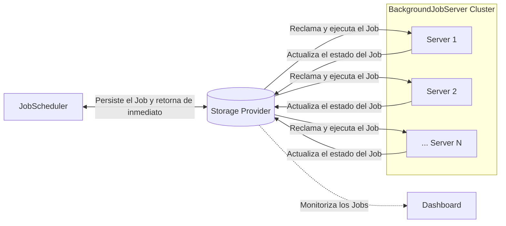

<div class="p-4 bg-black rounded-lg text-white mb-6">
  <strong class="text-white">JobRunr DocsGPT está aquí para ayudarte</strong><br>
  Entrenado con toda nuestra documentación, es la forma más rápida de desatascarte.<br>
  <a onclick="chatbase.open()" class="cursor-pointer text-white underline">Abre el chatbot ahora →</a>
</div>

## ¿Qué es JobRunr?

JobRunr es una forma sencilla de ejecutar tareas asíncronas de tipo fire-and-forget, diferidas y recurrentes en la JVM, usando solo lambdas de Java 8 y con ejecución distribuida entre varias instancias. Los jobs se guardan en tu base de datos actual, así que no se pierde nada tras un reinicio o un fallo. Los reintentos automáticos se encargan de los imprevistos, y un dashboard integrado te da visibilidad en tiempo real de cada job.

```java
BackgroundJob.enqueue(() -> emailService.sendWelcomeEmail(userEmail));
```

Con esa única línea tienes un background job persistente y distribuido. JobRunr serializa la lambda a JSON, la guarda en tu base de datos actual y devuelve el control de inmediato a quien la llamó. Un `BackgroundJobServer` la recoge y la ejecuta, ya sea en la misma JVM o en un clúster.

## ¿Por qué JobRunr?

**API pensada para desarrolladores:** sencilla y flexible, diseñada para encajar en cualquier arquitectura de software con dependencias mínimas y pocos cambios en tu código existente.

**Almacenamiento persistente:** JobRunr guarda los jobs en la misma base de datos SQL o NoSQL que tu aplicación ya usa (PostgreSQL, MySQL, MongoDB y más). Sin infraestructura adicional que mantener.

**Tolerante a fallos:** por defecto, cada job que falla se reintenta automáticamente hasta 10 veces con backoff exponencial. JobRunr gestiona los fallos transitorios (p. ej., cortes de red puntuales, caídas de servicios externos, reinicios de la aplicación) para que no tengas que hacerlo tú.

**Observabilidad integrada:** una interfaz web incluida ofrece un dashboard centralizado para monitorizar los jobs en tiempo real: inspecciona cualquier job, diagnostica fallos y vuelve a encolar o elimina jobs con un solo clic.

**Sin despliegue aparte:** JobRunr es una librería, no un servicio. Inclúyela en tu aplicación y no necesitarás un despliegue aparte. También puedes optar por desplegarla como un microservicio.

**Procesamiento distribuido:** escala horizontalmente ejecutando más instancias de tu aplicación. Cada una se une automáticamente al clúster de procesamiento y recoge jobs, con garantía de ejecución única.

## Cómo funciona JobRunr



1. Tu código llama a `BackgroundJob.enqueue()` (o a `schedule()`, o a `scheduleRecurrently()`).
2. El [JobScheduler]() inspecciona la lambda con ASM, serializa el tipo, el método y los argumentos a JSON, y escribe un registro `Job` en el [StorageProvider](). Justo después, el control vuelve a quien hizo la llamada.
3. Uno o varios [BackgroundJobServers]() consultan periódicamente el StorageProvider en busca de nuevos jobs encolados y los procesan. Además, el servidor que lleva más tiempo en ejecución se elige automáticamente como master y se encarga de las tareas de mantenimiento (encolar jobs planificados, planificar jobs recurrentes, eliminar jobs, etc.).
4. Si todo va bien, el job se marca como `SUCCEEDED`. Si falla, el [RetryFilter]() lo vuelve a planificar con backoff exponencial.
5. El dashboard te permite monitorizar todo tu sistema de planificación de jobs.

## Por dónde seguir

- **¿Estás aprendiendo lo básico de JobRunr?** Sigue leyendo esta página.
- **¿Acabas de empezar?** Elige una [guía de inicio rápido]() según tu stack. ¡Lo tendrás funcionando en 5 minutos!
- **¿Vas a añadir JobRunr a tu proyecto?** Consulta [Instalación]() y elige un [StorageProvider]().
- **¿Vas a integrarlo con tu framework?** Elige tu configuración: [Spring Boot](), [Micronaut](), [Quarkus]() o la [Fluent API]().
- **¿Necesitas funcionalidades avanzadas para empresas?** [JobRunr Pro]() añade batches, encadenamiento de jobs (es decir, workflows), colas de prioridad, rate limiting, SSO y más.



---

## Conceptos clave

### Planificar jobs y jobs recurrentes {#scheduling-jobs--recurring-jobs}

En el núcleo de JobRunr está la entidad `Job`: contiene el nombre, la firma, los `JobDetails` (el tipo, el método a ejecutar y todos los argumentos) y el historial, con todos los estados, del propio job en segundo plano. Un `Job` es una unidad de trabajo que debe ejecutarse fuera del contexto de ejecución actual, p. ej. en un thread en segundo plano, en otro proceso o incluso en otro servidor. Todo es posible con JobRunr, sin ninguna configuración adicional.

Un `RecurringJob` es, en esencia, un `Job` con una expresión `cron` o un intervalo fijo asociado. El nodo master comprueba en cada ciclo de polling qué jobs recurrentes toca ejecutar y los planifica. En términos más técnicos, un `RecurringJob` crea varios `Jobs` a lo largo de su vida.

#### Crear jobs

Puedes crear jobs de dos maneras: con una `JobLambda` o con un `JobRequest`.

**Con una lambda de Java 8:** pasa una lambda que referencie el método a ejecutar. JobRunr usa ASM para inspeccionarla y extraer el tipo, el nombre del método y los argumentos.

```java
BackgroundJob.enqueue(() -> emailService.sendWelcomeEmail(userEmail));
```

`BackgroundJob` es una clase de conveniencia con métodos estáticos de ayuda; por debajo delega en el `JobScheduler`. También puedes inyectar y usar el `JobScheduler` directamente, lo cual es preferible de cara a los tests.

Los jobs diferidos y recurrentes siguen el mismo patrón:

```java
// Se ejecuta una vez, dentro de 5 días
BackgroundJob.schedule(Instant.now().plus(5, DAYS), () -> emailService.sendFollowUp(userEmail));

// Se ejecuta cada día
BackgroundJob.scheduleRecurrently("daily-report", Cron.daily(), () -> reportService.sendDailyReport());
```

Si usas Spring, Micronaut o Quarkus, también puedes definir jobs recurrentes de forma declarativa con la anotación `@Recurring`. JobRunr los registrará automáticamente al arrancar.

El enfoque con lambdas es la opción menos invasiva, porque no hay que crear clases nuevas. Funciona con lambdas tanto de Java como de Kotlin.

**Con un `JobRequest`:** implementa la interfaz `JobRequest` para transportar los datos del job y combínala con un `JobRequestHandler` que haga el trabajo. Sigue el patrón command/handler y encaja bien cuando quieres una separación clara entre los datos del job y su lógica.

```java
// El request transporta los datos
public class SendEmailRequest implements JobRequest {
    private final String userId;
    // ...
    @Override
    public Class<SendEmailRequestHandler> getJobRequestHandler() {
        return SendEmailRequestHandler.class;
    }
}

// El handler hace el trabajo
public class SendEmailRequestHandler implements JobRequestHandler<SendEmailRequest> {
    @Override
    public void run(SendEmailRequest request) {
        // haz el trabajo
    }
}
```

Para crear un `Job` con este patrón tienes que usar `BackgroundJobRequest` o `JobRequestScheduler`. Por ejemplo, el `JobRequest` anterior se puede encolar así:

```java
BackgroundJobRequest.enqueue(new SendEmailRequest(userId));
```

`BackgroundJobRequest` y `JobRequestScheduler` ofrecen las mismas APIs que `BackgroundJob` y `JobScheduler`.

#### Configurar jobs

Hay dos formas de añadir información extra a un `Job`, como su nombre, el número de reintentos o sus labels.

**Anotación `@Job`:** colócala en el método que se ejecuta.

```java
@Job(name = "Send welcome email", retries = 3)
public void sendWelcomeEmail(String userEmail) { ... }
```

> [!TIP]
> `@Job` soporta la sustitución de parámetros con `%0`, `%1`, etc. para referenciar los argumentos del método por posición. Por ejemplo, `"Send welcome email to %0"` se resuelve como `"Send welcome email to email@example.com"` en tiempo de ejecución.

**`JobBuilder`:** úsalo cuando necesites más flexibilidad, p. ej., un nombre de job generado dinámicamente. Envuelve una lambda o un `JobRequest`.

```java
BackgroundJob.create(JobBuilder.aJob()
    .withName("Send welcome email to " + userEmail)
    .withAmountOfRetries(3)
    .withJobLambda(() -> emailService.sendWelcomeEmail(userEmail)));
```

### Persistir jobs con un StorageProvider {#persisting-jobs-with-a-storageprovider}

Un `StorageProvider` es el lugar donde JobRunr guarda toda la información relacionada con el procesamiento de jobs en segundo plano. Todos los detalles, como los tipos, los nombres de los métodos, los argumentos, etc., se serializan a JSON y se guardan en el almacenamiento; no se mantiene ningún dato en la memoria de un proceso. El `StorageProvider` está lo bastante bien abstraído en JobRunr como para poder implementarse sobre soluciones [tanto RDBMS como NoSQL]().

JobRunr soporta Jackson, Gson, JSON-B y Kotlin Serialization. Consulta [Serialización]() para ver cómo configurarlo.

> [!IMPORTANT]
> Esta es la decisión principal que debes tomar, y la única configuración necesaria antes de empezar a usar el framework.

### Procesar jobs con un BackgroundJobServer {#processing-jobs-with-a-backgroundjobserver}

El `BackgroundJobServer` se ejecuta dentro del proceso de tu aplicación y es el responsable de ejecutar los jobs. Consulta periódicamente el `StorageProvider` en busca de trabajo, reclama los jobs de forma atómica para que el mismo job nunca se procese dos veces e invoca el método de destino. Como todo el estado vive en el storage provider, los jobs nunca se pierden: incluso si un servidor se detiene en pleno procesamiento, otro servidor recogerá el job y lo reintentará tras el reinicio.

Para escalar horizontalmente, ejecuta más instancias de tu aplicación: cada una arranca un `BackgroundJobServer` y se une automáticamente al clúster. Un servidor se elige como **master** y se encarga de planificar los jobs recurrentes y de las tareas de mantenimiento. El resto actúan como workers.

> [!IMPORTANT]
> Por defecto, el `BackgroundJobServer` está desactivado. Tienes que activarlo explícitamente.

> [!CAUTION]
> Nunca arranques más de un `BackgroundJobServer` dentro de la misma instancia de la JVM.

#### Acceder al contenedor IoC de tu aplicación

Al ejecutar un job, JobRunr necesita resolver una instancia de la clase que contiene el método del job. Por defecto instancia la clase directamente, pero la mayoría de las aplicaciones usan un [contenedor IoC](https://en.wikipedia.org/wiki/Inversion_of_control) como Spring, Micronaut o Quarkus. La interfaz `JobActivator` te permite conectar tu contenedor: dada una clase, devuelve una instancia completamente inicializada. Si usas una integración con un framework, JobRunr lo configura automáticamente.

#### Gestionar fallos {#handling-failures}

Cuando un job falla, el `RetryFilter` integrado lo vuelve a planificar automáticamente con backoff exponencial, con 10 intentos por defecto. Una vez agotados todos los reintentos, el job pasa a `FAILED`, donde sigue visible en el dashboard hasta que hagas algo con él. Nunca se descarta en silencio.

Puedes personalizar el comportamiento de los reintentos con la anotación `@Job` o con un `JobBuilder`, o implementar tu propio `RetryFilter` o una `RetryPolicy` a medida en JobRunr Pro.

#### Extender JobRunr con JobFilters

JobRunr expone hooks `JobFilter` en cada etapa del ciclo de vida del job: antes y después de la creación del job (`JobClientFilter`), antes y después del procesamiento (`JobServerFilter`) y en las transiciones de estado (`ElectStateFilter`, `ApplyStateFilter`). Así puedes añadir lógica propia (auditoría, notificaciones, etc.) sin tocar los métodos de tus jobs.

### Monitorizar jobs con el dashboard

El `JobRunrDashboardWebServer` es una interfaz web integrada, disponible por defecto en `http://localhost:8000`. Te da una vista en tiempo real de todos los jobs y servidores: monitoriza los estados de los jobs, inspecciona los fallos con el stack trace completo, vuelve a encolar o elimina jobs y vigila tu clúster de procesamiento.

> [!IMPORTANT]
> Por defecto, el dashboard está desactivado. Tienes que activarlo explícitamente.

> [!PRO]
> ¿Necesitas búsqueda avanzada, autenticación, un context path personalizado o integrarlo en el servidor de tu framework? Consulta [JobRunr Pro Dashboard]().
